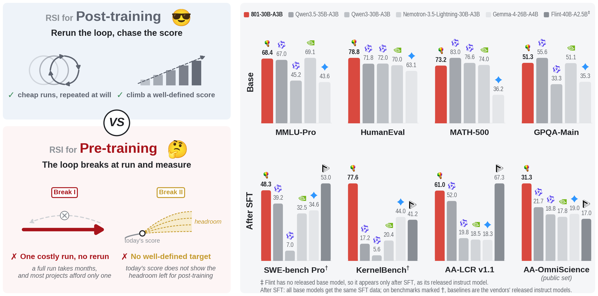
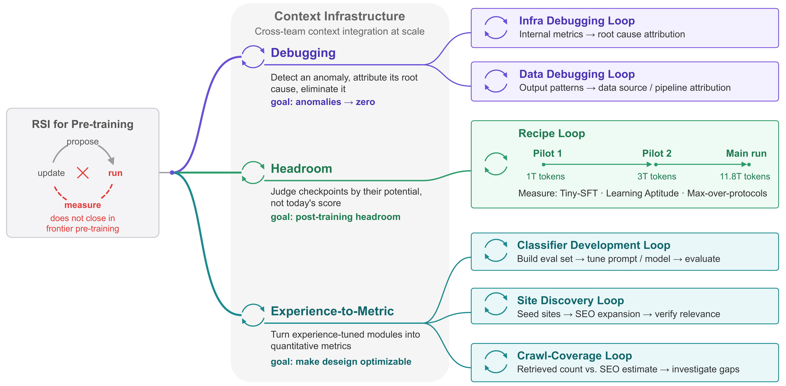
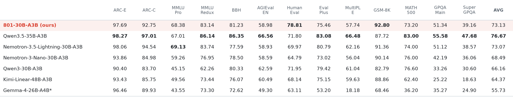
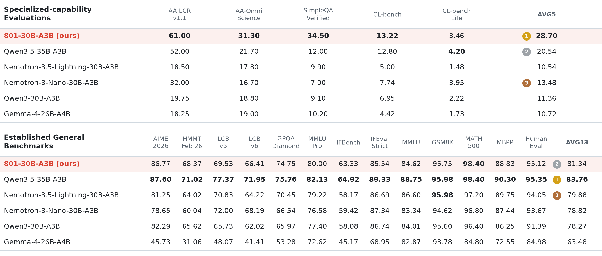
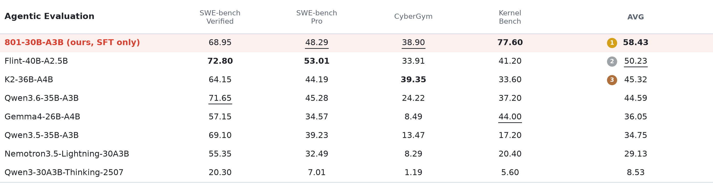

<div align="center">


&nbsp;&nbsp;&nbsp;&nbsp;
<picture>
  <source media="(prefers-color-scheme: dark)" srcset="assets/logo_sii_gair_dark.png">
  
</picture>
&nbsp;&nbsp;&nbsp;&nbsp;
<picture>
  <source media="(prefers-color-scheme: dark)" srcset="assets/logo_xinxu_dark.png">
  
</picture>

# No Second Run: Does RSI Stop at Frontier Pre-training?

**801-30B-A3B-Base** · *SII & Xinxu AI*

[](report.pdf) [](https://github.com/GAIR-NLP/801-30B) [](https://huggingface.co/datasets/GAIR/801-30B-A3B-tiny-sft-dataset)

</div>

<p align="center">
  
</p>

> **801** (pronounced *eight-oh-one*) is named after the classroom where it was built.

## TL;DR

- **First RSI applied to an entire frontier pre-training run.** To our knowledge, this is the first public, detailed account of recursive self-improvement (RSI) on a full pre-training run from scratch, not just on post-training or small-scale proxies.
- **801-30B-A3B-Base**: a 30B-A3B MoE model trained from scratch on **11.8T tokens** in **three months** by a **newly formed team**.
- **State-of-the-art open base model at the 30B MoE scale.** It beats Qwen3-30B-A3B and Nemotron-3.5-Lightning-30B-A3B and trails only the larger Qwen3.5-35B-A3B. It holds that position when every model gets **identical SFT**.
- **Strong agentic headroom.** With only a **6.33B-token SFT** (no RL), it has the **highest average on four agentic benchmarks** among the fully post-trained models we compare, including Qwen3.6-35B-A3B.

## Why RSI Is Different in Pre-training

Public RSI work runs the loop **propose → run → measure → update** on post-training, where trials are cheap and scores are verifiable. Frontier pre-training breaks both conditions:

|  | RSI for post-training | RSI for frontier pre-training (ours) |
|---|---|---|
| Starting point | An existing base model | Random initialization |
| Cost per trial | GPU-hours | Hundreds of thousands of GPU-hours for one run |
| Full-length trials | Tens to hundreds | **One** |
| Signal at *measure* | Verifiable task score | Post-training headroom, not readable from any single score |
| Data | A fixed dataset or environment | 6 pipelines, >30 stages, 1,053 subsets, 10.5T unique tokens |
| Infrastructure | A training script | >130 code versions, 106 hyperparameter fields |
| What improves | A model or a harness | A production system and the organization that runs it |

Our answer: **RSI does not stop at frontier pre-training, but it changes form.** No end-to-end loop can close over a single run that cannot be repeated. So we split the pre-training loop into **smaller loops that can close**, each one repairing a step the full run breaks.

## Three Types of Loops, Six Practical Loops

<p align="center">
  
</p>

| Loop type | Instances | What it repairs |
|---|---|---|
| 🔧 **Debugging** | Infra debugging loop · Data debugging loop | Moves *run* onto the infra and data stacks, where a diagnosis can be rerun cheaply. Traces internal-metric and output anomalies to their root causes. |
| 📈 **Headroom** | Recipe loop (Pilot 1 → Pilot 2 → Main run) | Repairs *measure*. Judges checkpoints by post-training potential (**Tiny-SFT**, **Learning Aptitude**, **Max-over-protocols**) instead of today's score. |
| 📏 **Experience-to-Metric** | Classifier development · Site discovery · Crawl coverage | Builds a *measure* where none existed. Turns judgment once made by feel into quantitative feedback that agents can optimize. |

All loops share a **Context Infrastructure**, the organization's memory. It brings together evidence from the data, infra, training, and evaluation teams, and it keeps negative results along with the reasons they failed. The *update* step persists here, and this is where the recursion lives.

### Highlights

- **Debugging loops**: agents found causes spread across infra, data, and recipe. Examples include a load-balance penalty interacting with optimizer state, layer-specific MoE imbalance hidden by aggregate metrics, and low-diversity synthetic data. They resolved **five cross-stack diagnoses in about one month**. Together with data and recipe revisions, the mean score over 22 benchmarks at a matched 1T-token budget rose **47.78 → 51.96 → 56.83**.
- **Headroom loop**: Tiny-SFT exposed **false stagnation**. Base scores plateau while post-SFT scores keep rising, e.g. SFT AVG13 **70.54 → 72.93** over 8.1T–11.5T tokens. Base and post-SFT checkpoint rankings also disagree (Spearman ρ = 0.44 in Stage1-2/1-3).
- **Experience-to-metric loops**: six data pipelines built from scratch in under three months, with agents contributing 36 model-selection decisions, prompt optimization, and classifier construction.
- **Agentic data at pre-training scale**: 260K raw PRs → **220K executable tasks** → rolled out across **9 harnesses** (Claude Code, Codex, OpenHands, SWE-agent, …) → **1.1M verified trajectories (>100B tokens)**, with agent-driven anti-hacking checks. In total, **134B agentic tokens** go into the long-context stage of pre-training.

## Results

### Base Model

<p align="center">
<picture>
  <source media="(prefers-color-scheme: dark)" srcset="assets/results_base_dark.png">
  
</picture>
</p>

<sub>All entries are base checkpoints. \*Gemma-4-26B-A4B reports the max score across multiple prompts and evaluation protocols per benchmark.</sub>

### Base + Tiny SFT (6.33B tokens)

<p align="center">
<picture>
  <source media="(prefers-color-scheme: dark)" srcset="assets/results_sft_dark.png">
  
</picture>
</p>

<sub>Every base model is fine-tuned on the same 6.33B-token SFT data ([GAIR/801-30B-A3B-tiny-sft-dataset](https://huggingface.co/datasets/GAIR/801-30B-A3B-tiny-sft-dataset)), so differences mainly reflect the base models.</sub>

### Agentic: Tiny SFT vs. Fully Post-trained Models

<p align="center">
<picture>
  <source media="(prefers-color-scheme: dark)" srcset="assets/results_agentic_dark.png">
  
</picture>
</p>

<sub>Baselines are provider-released, fully post-trained models; 801-30B-A3B has only the 6.33B-token SFT. This is a reference point for post-training headroom, not a like-for-like comparison.</sub>

## Release

- 📄 **Technical report**: [`report.pdf`](report.pdf)
- 🤗 **Tiny-SFT dataset**: [GAIR/801-30B-A3B-tiny-sft-dataset](https://huggingface.co/datasets/GAIR/801-30B-A3B-tiny-sft-dataset), the lightweight SFT data used in the report. It is a ready-made resource for evaluating the post-training headroom of base models.
- 🧠 **801-30B-A3B-Base**: coming soon.

## Citation

```bibtex
@techreport{801-30b-a3b,
  title       = {No Second Run: Does RSI Stop at Frontier Pre-training?},
  author      = {{SII} and {Xinxu AI}},
  year        = {2026},
  url         = {https://github.com/GAIR-NLP/801-30B}
}
```
